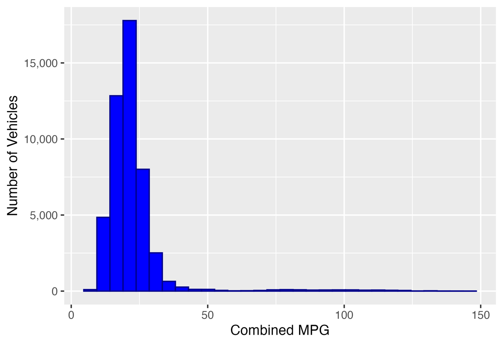
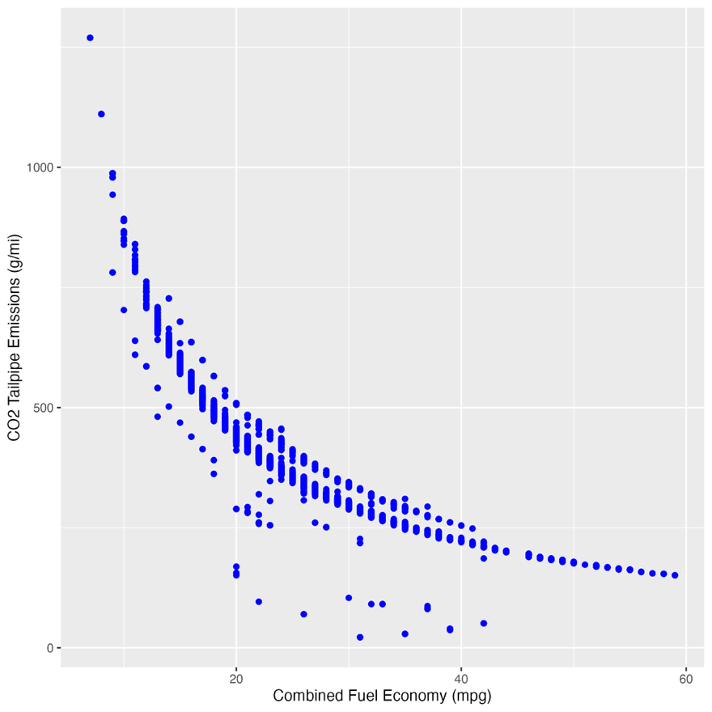
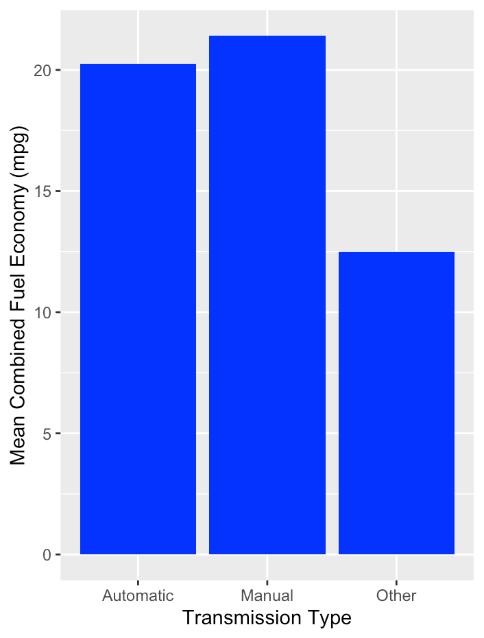
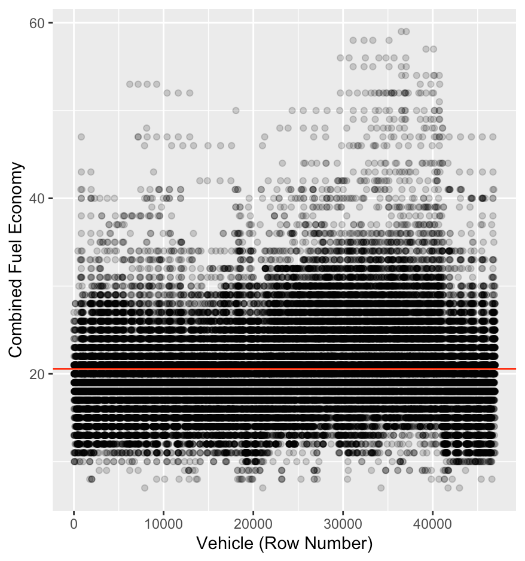

# EPA Vehicle Fuel Economy Analysis

**Exploratory Data Analysis · Data Cleaning · Visualization · Linear Regression · R**

A portfolio-ready analysis of public U.S. vehicle fuel-economy records for
**model years 1984-2025**. The project investigates how combined MPG varies
across vehicle characteristics and compares simple statistical models.

**Tools:** R, dplyr, ggplot2, readr, and base R regression (`lm`).

## Project highlights

- Analyze combined city/highway MPG, petroleum use, CO2 emissions and drive type.
- Clean and filter the data, including non-plug-in and positive tailpipe CO2 criteria.
- Produce descriptive summaries and charts for transmission categories.
- Compare an intercept-only baseline with two linear regression models.
- Explain model limitations, especially the use of petroleum consumption,
  a feature derived from MPG rather than independent of it.

## Example visualizations

The images below are **historical charts extracted from the original 2024-data
coursework report**. Running the revised scripts generates fresh figures in
`outputs/figures/` using your newly downloaded version of the data.

| Combined MPG distribution | MPG and tailpipe CO2 |
|---|---|
|  |  |

| Mean MPG by transmission | Intercept-only baseline |
|---|---|
|  |  |

## Findings from the original report (2024 data snapshot)

| Model | Adjusted R² | Residual standard error |
|---|---:|---:|
| Drivetrain | 0.249 | 4.74 MPG |
| Annual petroleum consumption | 0.813 | 2.37 MPG |

**Interpretation:** Petroleum consumption appears strongly associated with
MPG because it is calculated from fuel-economy measures. The high model fit
is therefore *not* evidence of independent explanatory or causal power.
These numbers describe the **original report**, not the output of the revised
scripts. See [the case study](report/PROJECT_SUMMARY.md) for scope and caveats.

## How to run this project

1. Install [R](https://cran.r-project.org/) and optionally
   [RStudio](https://posit.co/download/rstudio-desktop/).
2. Open a terminal in this repository's main folder.
3. Install required packages once:

   ```r
   install.packages(c("dplyr", "ggplot2", "readr"))
   ```

4. Download the dataset and run the analysis:

   ```bash
   Rscript download_data.R
   Rscript run_analysis.R
   ```

   Or, from the RStudio console while your working directory is the repository
   root: `source("download_data.R")`, then `source("run_analysis.R")`.

If the download is unavailable, visit
[FuelEconomy.gov's data downloads](https://www.fueleconomy.gov/feg/download.shtml)
and save `vehicles.csv` into `data/` manually.

**Generated files:** `outputs/figures/*.png`, `outputs/tables/*.csv`, and
`outputs/run_summary.txt`. The `outputs/` folder is intentionally excluded
from Git to keep the committed repository clean.

## Files and structure

```text
epa-fuel-economy-analysis/
├── README.md
├── download_data.R              # Get official data
├── run_analysis.R              # Run all four analysis stages
├── R/
│   ├── 00_utils.R              # Shared helpers
│   ├── 01_exploratory_analysis.R
│   ├── 02_cleaning_and_visualization.R
│   ├── 03_baseline_model.R
│   └── 04_regression_comparison.R
├── data/README.md              # Data dictionary and source
├── figures/                    # Original report chart images (historical)
└── report/
    ├── PROJECT_SUMMARY.md      # Methods, findings and limitations
    └── portfolio_case_study.pdf
```

## Data quality and reproducibility

This project filters to model years **1984-2025** but downloads the public
live dataset, which can change after publication. Consequently, new runs may
have different counts, charts, and coefficients. The accompanying historical
charts/report reflect the original 2024 downloaded snapshot.

Ambiguous drive labels are excluded from the regression comparison rather than
assigned an assumed drivetrain. Both comparison regressions use the same
filtered rows. This is a deliberate improvement over the original classroom
simplification, so model results should not be expected to reproduce the
historical table exactly.

## Next steps

An extension using engine displacement, cylinders, model year, and held-out
validation would test explanatory features that are less directly constructed
from MPG itself.

## Data credit

U.S. Department of Energy and U.S. Environmental Protection Agency,
[FuelEconomy.gov vehicle data](https://www.fueleconomy.gov/feg/download.shtml).
The report figures are from the author's original analysis of that source.
